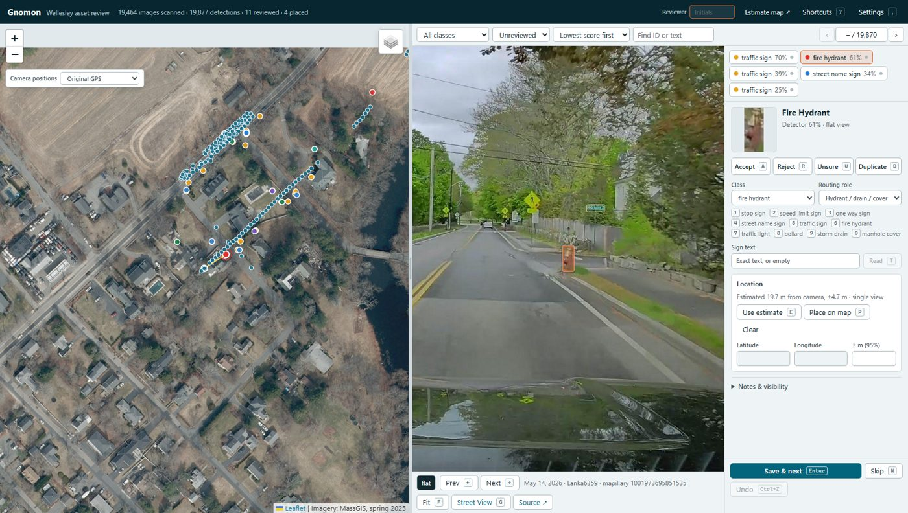
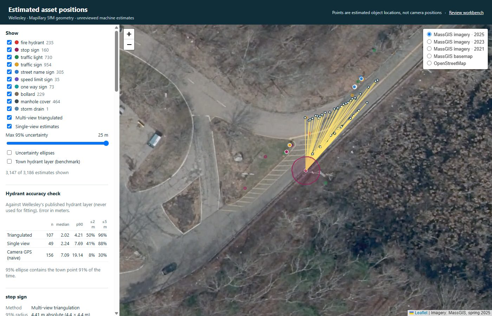
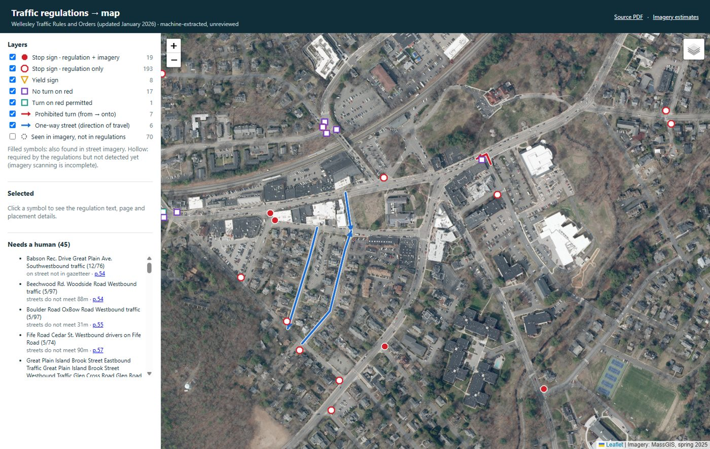

# Gnomon

Turn street-level imagery into a reviewed, mapped inventory of roadside assets (signs, signals, hydrants, covers), with each asset placed where it **physically** stands, not where the camera was. Pilot: Wellesley, MA.



## How it works

1. **Inventory imagery.** Pull every Mapillary and Panoramax image in the town, with rights and capture metadata (`wellesley_pipeline.py inventory`, `wellesley_inventory_worker.py`).
2. **Detect assets.** Cut panoramas into six cube faces and run YOLO-World on the GPU (`wellesley_gpu_worker.py`).
3. **Check camera positions.** Flag GPS tracks that disagree with the road network and propose reversible corrections (`position_quality.py`).
4. **Locate each detection.** Use Mapillary's structure-from-motion camera pose for a precise bearing, then measure distance four ways: SfM points in the box, ground-contact ray on a measured road plane, SfM-anchored monocular depth, and standard sign sizes. Fuse them, triangulate repeat sightings, and self-calibrate (`asset_localization.py`, `depth_cue.py`).
5. **Review.** In the workbench, confirm or fix the class, routing role, text and position with one-key hotkeys, Street View checks, and an undoable, attributed save (`review_server.py`).
6. **Benchmark.** Score positions against Wellesley's published hydrant layer, which is never used for fitting.



**Accuracy (Wellesley hydrants):** median error **2.1 m** against 7.1 m for using camera GPS, and 94% within 5 m. The 95% uncertainty ellipses contain the town's point 91% of the time. Details in [LOCALIZATION.md](LOCALIZATION.md).

## Traffic regulations → map

Towns record stop signs, turn prohibitions and one-way streets in their *Traffic Rules and Orders*: legal text with no coordinates. Gnomon turns that text into GIS layers, so the imagery can be checked against what the law requires. Plan and results: [REGULATIONS_PLAN.md](REGULATIONS_PLAN.md).

1. **Extract** the PDF text in row order (`pdftotext -raw`).
2. **Parse** the table schedules (stop, yield, turn on red) with code. Each row is split into *on street / at street / direction* by matching the town's street names.
3. **Read** the free-form schedules (turns, one-way) with OpenAI `gpt-6-luna`, validated against the street names. A record is kept only if 2 of 3 runs agree.
4. **Geocode** to the intersection of the two street centerlines. No geocoding service is needed.
5. **Place** each sign on the approach for the stated direction, right-hand side, with distances self-calibrated against signs triangulated from imagery.
6. **Cross-check** against imagery detections: required-but-not-seen and seen-but-not-required become review lists.



**Statewide:** agent swarms searched all 350 municipalities except Boston (live dashboard: `swarm.html`). 43 towns are mapped so far, with **4,503 stop signs** (map: `statewide.html`). Every document is checked for the right town before mapping.

**Wellesley:** 212 of about 235 listed stop signs placed (90%), plus 8 yield signs, 18 turn-on-red rules, 7 prohibited turns and 6 one-way streets. Placement error is a 4.4 m median against imagery-triangulated signs. Model reading of the free-form schedules scored 99.5% field accuracy against hand-checked answers, at about $0.002 per document. Unplaced rows are listed with reasons for review.

```
python reg_harness.py run          # parse, geocode, place, cross-check (no model)
python reg_ai.py all               # free-form schedules with gpt-6-luna (OPENAI_API_KEY)
python -m http.server 8000         # → http://localhost:8000/regulations.html
```

## Run it

```
pip install -r requirements.txt
# MAPILLARY_ACCESS_TOKEN=... in .env

python wellesley_inventory_worker.py                 # 1. inventory (resumable)
<gpu-env>/python wellesley_gpu_worker.py             # 2. detect (resumable; create data/wellesley/STOP to stop)
python position_quality.py qa                        # 3. camera QA
python asset_localization.py enrich                  # 4. SfM pose + mesh per image
<gpu-env>/python depth_cue.py                        #    anchored depth
python asset_localization.py run                     #    localize, triangulate, calibrate, benchmark
python review_server.py                              # 5. workbench → http://localhost:8001
```

In the workbench, press `?` for shortcuts and `,` for settings (map symbology, layers, theme, hotkey remapping). Blind benchmark labeling is at `/review.html`, and the estimate map is at `/assets.html`.

## Docs

- [LOCALIZATION.md](LOCALIZATION.md): positioning method, verified conventions, results, limits
- [POSITION_ERROR_AND_SIGN_PLACEMENT.md](POSITION_ERROR_AND_SIGN_PLACEMENT.md): camera GPS errors and placement rules
- [REGULATIONS_PLAN.md](REGULATIONS_PLAN.md): traffic regulations → GIS, scaling to Massachusetts
- [research/ground_truth_sources.md](research/ground_truth_sources.md): existing sign, signal and hydrant data in Wellesley and Massachusetts
- [PLAN.md](PLAN.md), [WELLESLEY_METHODOLOGY.md](WELLESLEY_METHODOLOGY.md), [REVIEW_AND_BENCHMARK.md](REVIEW_AND_BENCHMARK.md), [COVERAGE.md](COVERAGE.md): project plan, inventory, review and coverage notes
- [PRODUCT.md](PRODUCT.md): workbench design brief

Data, imagery, databases, model weights and `.env` are not committed; the scripts regenerate them. Machine estimates are unreviewed. Screenshots: street imagery © Mapillary contributors (CC BY-SA 4.0); aerial imagery © MassGIS.
